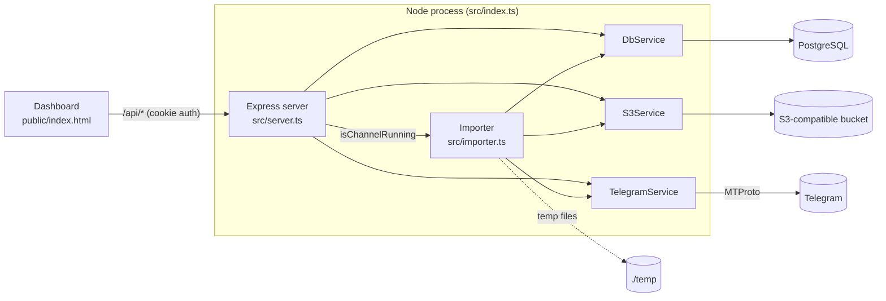

# Architecture

How the importer is put together, what it stores, and how it behaves when things go wrong.

## Context

The importer is Stage 1 of a four-stage pipeline that migrates audio lectures and their descriptions out of Telegram. It pulls every message and attachment from a public channel. It also stores the text↔audio pairs from the Stage 2 mapper in `channel_mappings`. [pipeline.md](pipeline.md) covers all four stages, the services that own them, and the data they read from this one.

## Components

One Node process runs everything:



`src/index.ts` constructs the `pg` pool, `S3Client`, and the three services, and injects them into `Importer` and `createServer`. Nothing else constructs a service, which is why the tests can swap in mocks.

### Boot sequence

1. Parse and validate config (`src/config.ts`). A missing required variable stops startup with the full list of what's missing.
2. `DbService.initializeSchema()`: idempotent `CREATE ... IF NOT EXISTS` inside a transaction.
3. `TelegramService.connect()`: load the session from `TELEGRAM_SESSION` or the session file. If there is none, prompt for phone, code and 2FA (TTY only; headless throws). Save a newly created session back to the file.
4. Reset every channel with `status = 'running'` back to `pending` (crash recovery).
5. `importer.start()`: begin the scheduler loop.
6. Start Express on `PORT`.

The Postgres pool is built with `ssl: { rejectUnauthorized: true }`, so the database must accept verified TLS. Because the schema step runs before the Telegram login, even the first interactive login needs a reachable database.

SIGINT/SIGTERM: close HTTP, set the importer's stop flag, disconnect Telegram, drain the pool, exit. In-flight imports aren't awaited; they stop at the next message boundary or are cut off, and step 4 cleans up on the next boot.

## Import algorithm

**Scheduler** (`Importer.tick`, every 5s, and immediately after a job finishes): if fewer than `IMPORT_CONCURRENCY` jobs are active, take `pending` channels from `getAllChannels()` and start each one not already in the in-memory `runningChannels` set.

**Per channel** (`Importer.importChannel`):

```
status := running
entity := resolve(channel_username || channel_id)
upsert channel (resolved id, username, title)
minId := last_processed_message_id || 0
loop:
  batch := getMessages(entity, minId, limit 100, oldest→newest)   // id > minId
  if batch empty: status := completed; stop
  for msg in batch:
    if msg has photo/document:
      key := existing media_key for (channel, msg)
      if no key: key := download → temp file → stream to S3 → delete temp   (null on failure)
    upsert message (clean JSON, date, key)        // errors: log, continue
  last_processed_message_id := max id in batch
on any uncaught error: status := failed
```

Every Telegram call (resolve, fetch, download) goes through `executeWithRetry`. A FloodWait sleeps for the requested time with no retry limit; any other error is retried 5 times with exponential backoff (2s, 4s, 8s, 16s), and then the channel fails.

## Data model

All tables are created by `DbService.initializeSchema()`.

### `telegram_channels`

| Column | Type | Notes |
|---|---|---|
| `channel_id` | `BIGINT` PK | Telegram channel ID (resolved at registration) |
| `channel_username` | `TEXT` | Without `@`. Duplicate checks compare it case-insensitively |
| `title` | `TEXT` | |
| `status` | `TEXT` | `pending` → `running` → `completed` / `failed` |
| `last_processed_message_id` | `BIGINT` | Resume checkpoint, written after each batch |
| `import_started_at` | `TIMESTAMP` | Set the first time a channel becomes `running` |
| `import_completed_at` | `TIMESTAMP` | Set on `completed` |

A `failed` channel stays failed until something sets it back to `pending`. There is no API or UI for that yet, so it's a manual SQL `UPDATE`.

### `telegram_messages`

| Column | Type | Notes |
|---|---|---|
| `id` | `BIGSERIAL` PK | Internal |
| `channel_id`, `message_id` | `BIGINT` | `UNIQUE (channel_id, message_id)` + index |
| `message_date` | `TIMESTAMP` | From Telegram (UTC epoch → JS Date) |
| `telegram_json` | `JSONB` | Clean payload, below |
| `media_key` | `TEXT` | S3 key, or `NULL` (no media, or the upload failed) |
| `imported_at` | `TIMESTAMP` | Default `NOW()` |

### `channel_mappings`

Text↔audio pairs written by the mapper UI through `PUT /api/channels/:channelId/mappings` (see [api.md](api.md#mappings)).

| Column | Type | Notes |
|---|---|---|
| `channel_id`, `media_message_id` | `BIGINT` | `PRIMARY KEY`: one text per audio |
| `text_message_id` | `BIGINT` | Indexed with `channel_id`. One text can serve many audios |
| `source` | `TEXT` | `CHECK` in `manual`, `auto`, `unknown` |
| `created_at`, `updated_at` | `TIMESTAMPTZ` | Default `NOW()`. Time zone aware, unlike the older tables, so the API returns correct UTC times |

A PUT replaces the channel's whole set in one transaction: it locks the channel row with `SELECT … FOR UPDATE`, then runs `DELETE` plus one bulk `INSERT … SELECT FROM unnest(…)`. The lock makes overlapping PUTs for one channel run one after the other, so the last write wins instead of failing on the primary key. The IDs refer to `telegram_messages.message_id` of the same channel. The API checks that at write time.

There are no foreign keys between the tables. `deleteChannel` removes the channel, its messages and its mappings in one transaction. It takes the same channel row lock first, so a PUT that overlaps a delete either commits before it (and the delete removes its rows) or finds no channel and returns `404`. Neither order leaves mapping rows without a channel.

### `telegram_json` shape

Produced by `Importer.extractCleanJson`:

```json
{
  "message_id": 4567,
  "channel_id": "123456789",
  "date": "2026-06-17T08:00:00.000Z",
  "text": "Lecture 12 — Part 2",
  "views": 2500,
  "forwards": 32,
  "edit_date": null,
  "reply_to": { "reply_to_msg_id": 4560 },
  "media": {
    "media_type": "voice",
    "file_name": "voice_4567.ogg",
    "mime_type": "audio/ogg",
    "file_size": 1024567
  }
}
```

`reply_to` and `media` appear only when present. `media_type` is one of `photo`, `video`, `audio`, `voice`, `document`, `other`. `file_size` is the size actually downloaded when the download succeeded, and Telegram's reported size otherwise.

### Object storage

Key: `telegram/<channel_id>/<message_id>/<filename>`, uploaded with the Telegram MIME type as `Content-Type`. Filenames come from `TelegramService.extractMediaMetadata`: the original document name when Telegram has one, otherwise `photo_<id>.jpg`, `voice_<id>.ogg`, `document_<id>.<subtype>` or `attachment_<id>.bin`.

## Reliability properties

| Situation | What happens |
|---|---|
| Process crash or restart | `running` → `pending` on boot. Import resumes from `last_processed_message_id`. At most the in-progress batch is fetched again, and the upsert makes that harmless. |
| Same message processed twice | Upsert on `(channel_id, message_id)`. An existing `media_key` is kept (`COALESCE`), and stored media is never downloaded again. |
| FloodWait | Sleeps for the requested time, then continues. The channel stays `running`. |
| Network blip | Up to 5 attempts with backoff, then the channel becomes `failed`. |
| Media download/upload fails | Logged. The message is stored with `media_key = NULL` and the import continues. **Not retried later** (see [status.md](status.md#known-issues)). |
| One message throws | Logged and skipped. Progress still moves past it. |
| Disk | Each attachment exists in `./temp` only between its download and upload, and is removed in a `finally`. |

## Dashboard

`public/index.html` is a single vanilla HTML/CSS/JS file served statically. It polls `GET /api/progress` every 2s and patches rows in place, keyed by channel ID. The explorer modal loads `GET /api/channels/:id/messages` and previews media through `GET /api/media`. Any 401 redirects to `public/login.html`. Design and polling rules live in `.claude/rules/dashboard-ui-*.md`.

## Authentication

The only credential is the shared password `DASHBOARD_PASSWORD`. `POST /api/auth/login` sets an `HttpOnly; SameSite=Strict` cookie, `dashboard_token=sha256(password)`, valid for 30 days. Every `/api/*` route except login checks it, and `/` redirects to the login page without it. Changing the password logs everyone out. There are no per-user accounts and no server-side sessions.
