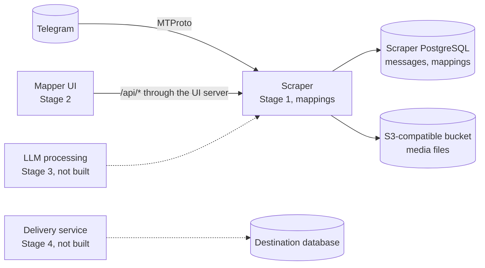

# How the scraper fits into the migration pipeline

The scraper runs Stage 1 of a four-stage pipeline that moves Telegram audio lectures and descriptions into a destination database. This page explains each stage, which service owns it, and which data the other stages read from the scraper. Read it before you change anything another stage depends on.

## The four stages

The end result is one validated record per audio lecture, with its description. Automation does the bulk work, and a person checks every result where correctness matters:

| Stage | Goal | Owner | State |
|---|---|---|---|
| 1. Export and queue | Copy every message and media file of a public channel | This scraper | Built |
| 2. Map text to audio | Pair each audio message with the text message that describes it | Mapper user interface (UI), `../telegram-pipeline-ui`, with storage here | Built |
| 3. Process text with a large language model (LLM) | Clean, translate and tag each description, then a person reviews the changes | Not decided | Not built |
| 4. Validate and deliver | A person reviews every record, then all records go into the destination database in one transaction | A separate delivery service | Not built |

The product spec for all four stages is `docs/requirements.md` in the mapper UI repo. That spec still names an n8n workflow and audio streaming for Stage 1; this scraper replaced both.



Solid arrows exist today. Dotted arrows are planned, and their exact source is still open.

## What the scraper does in each stage

The scraper owns Stage 1 and stores the output of Stage 2. It has no part in Stage 4:

- **Stage 1**: you register a channel handle, and the importer copies its full history. Messages go to `telegram_messages`, media files go to the bucket, and the channel status shows progress (`pending`, `running`, `completed`, `failed`). Audio stays in its original format. The scraper doesn't convert it to a streaming format, so the mapper plays the original file through `GET /api/media`.
- **Stage 2**: the mapper reads messages and audio from the HTTP API, and a person pairs them in the browser. The UI runs the detection heuristics that suggest pairs. When the person presses **Send**, `PUT /api/channels/:channelId/mappings` replaces the stored set in `channel_mappings`, and `GET /api/progress` reports `mapping_count` per channel.
- **Stage 3**: the scraper is the planned input. Stage 3 needs each mapped description, which is `telegram_json.text` of the text message in a mapping. The scraper has no endpoint or table for Stage 3 results yet.
- **Stage 4**: the delivery service writes to the destination database, which is a different database from the scraper's. The scraper's PostgreSQL is the working store for Stages 1 and 2.

## How the mapper UI calls this service

The browser can't call the scraper: its auth cookie is `HttpOnly`, and it sends no cross-origin resource sharing (CORS) headers. Instead, the UI's own server logs in with `DASHBOARD_PASSWORD`, keeps the cookie, and calls `/api/*` for the browser. That server also reshapes responses for the UI, and its media route accepts only keys in the scraper's layout. `docs/scraper-integration.md` in the mapper UI repo covers the UI side.

## Data other stages depend on

Later stages read these parts of the scraper, so treat each one as a contract. If you change one, update the mapper UI's adapters in the same change and note it in [status.md](status.md):

- **`telegram_json` shape**: the mapper reads `text`, `date` and `media` (`media_type`, `mime_type`). A message counts as audio when `media_type` is `audio` or `voice`, or `mime_type` starts with `audio/`. `PUT …/mappings` validates with the same rule.
- **Media key layout**: `telegram/<channel_id>/<message_id>/<filename>`. The mapper's media route rejects any other key.
- **Mappings**: one row per audio message in `channel_mappings`, keyed by `(channel_id, media_message_id)`. One text can describe several audio messages.
- **Deletions**: one row per deleted message and role in `channel_deletions`, keyed by `(channel_id, message_id, role)`, with `role` `audio` or `text`. A person deletes a message in the mapper when it does not need processing. It is a soft delete: the message stays in `telegram_messages` and the bucket. **Stage 3 and later must skip a deleted audio** (a `role` `audio` row), and must not treat it as unmapped work. A deleted audio counts as handled, so a batch is done when `mapped_audio_count + deleted_audio_count == audio_count`. A `role` `text` row means the text card is not needed. Do not use that text as a description for a mapping. The save checks only that a batch's own mappings do not use its deleted texts, so a mapping in another batch can still point at a deleted text.
- **Batches**: `channel_batches` splits each channel into message ranges for the mapper (see [batching.md](batching.md)). A `frozen` batch keeps its `batch_no` and range for as long as the channel exists, so a client can track progress per batch. Only the last batch can be `open`, and a rebuild can replace it.
- **IDs**: channel and message IDs are BigInt values, and the API sends them as JSON strings.
- **HTTP API**: the request and response shapes in [api.md](api.md), including the `{ success, … }` envelope and the error codes.

## Eval fixture export

The mapper UI has an offline harness that scores its pair detection against human-saved pairs. `scripts/export-eval-fixtures.ts` builds the data for it from the stored `channel_mappings`. The shape is the UI's `EvalFixtureSchema` (`lib/automation/eval-fixture.ts` in the UI repo): `{ version: 1, source, batches[] }`. Each batch holds the channel handle and ID, the batch number, the stored `batch_order` as `order` (`legacyOrder` is always `null`), the messages of the range oldest first, the closest earlier text (`contextMessage`), the texts outside the range that the pairs use (`linkedMessages`), and `expected` (audio ID to text ID, only for mapped audio). Message IDs are strings. A message is in the file when it is audio or has text. The date is `telegram_json.date` (ISO, UTC).

```bash
npx ts-node scripts/export-eval-fixtures.ts --channel <handle> [--batches 1,2] --out <path> [--no-ssl]
```

- The script only reads (`SELECT`). It takes `POSTGRES_*` from the environment (`.env` is loaded). Postgres TLS is on as in `src/index.ts`; `--no-ssl` turns it off for a local container.
- `--out` is required and there is no default path. The script refuses to write a file over 1,000,000 bytes and writes nothing then. It skips batches that have no mappings.
- **Deleted messages are excluded.** A message deleted as audio is not audio in the export, a message deleted as text has no text, and a message with neither side left is dropped. A mapping that uses a deleted audio or a deleted text is not exported as a label. A text outside the range that was deleted in another batch is not checked (the known gap of [deletions](#data-other-stages-depend-on)).
- **Privacy:** the file holds real channel message text. Keep it out of git and out of public places. The file is created with mode `0600`.

## Open decisions about the pipeline

Three pipeline decisions are still open, and [status.md](status.md#open-questions) tracks them:

- Who builds Stage 3, and where its results live
- How the delivery service gets validated records
- Where the Stage 4 review grid runs
